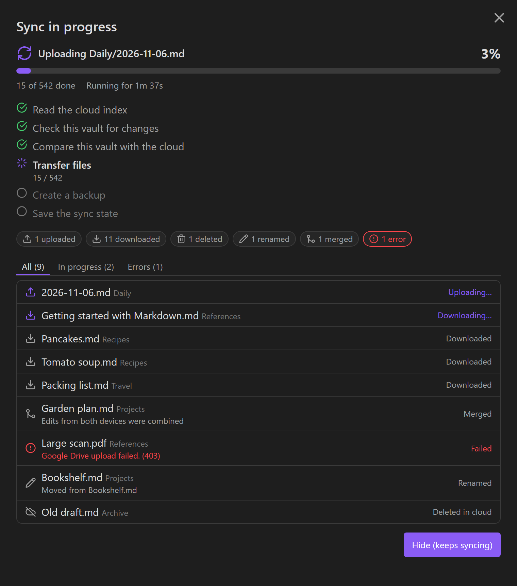

# Drive Vault Sync

Two-way sync between your Obsidian vault and **your own Google Drive** — on desktop and mobile.



- **Live progress for everything it does.** A progress window shows each step (reading the cloud index, checking your vault, comparing, transferring, backing up, saving), every file being uploaded, downloaded, deleted, renamed, merged or backed up, a percentage, an estimate of the time left and per-file errors. The status bar shows the same at a glance; on phones, a notice shows how many files are done.
- **Your edits are merged, not overwritten.** If the same note was edited on two devices in different places, the changes are combined automatically. Only overlapping edits ask you what to keep — with a side-by-side difference view.
- **Safety first.** Before a sync overwrites or deletes anything, the previous version is backed up to Google Drive. Large deletions stop and ask for confirmation. Local deletions go to the trash.
- **Fast and light.** Only changed files are read and hashed. Changes from your other devices are detected with a tiny metadata request instead of downloading the whole index.
- **Works offline.** Changes made without a connection are queued and sent later.
- **Problems are visible.** Files that fail to sync are listed with their error and retried automatically; a copyable sync log helps with troubleshooting.
- **Backups you control.** Automatic backups (only when needed, regularly, or on every sync) plus named full backups that are kept until you delete them. Preview, compare and restore single files or whole backups.
- **Easy multi-device setup.** Sign in once, then move the sign-in to your phone or tablet by scanning a (password-protected) QR code.

> **Note on 1.1.0–1.2.0.** The `main.js` in releases 1.1.0 and later was **not** built from `src/` in this repository. `src/` still holds 1.0.2. Release 1.2.0 is the 1.1.0 bundle with a local patch. [`patches/1.2.0/`](patches/1.2.0/) has the diff, a description of the changes and tests. The 1.1.0 source still has to be restored and the patch ported into `src/`. Until then, `npm run build` produces 1.0.2 code.

## Before you start

- **Back up your vault** before the first sync. Sync software moves and deletes files by design; a bug, an interrupted run or a wrong choice can lose data.
- You need a Google account and a free **Google OAuth client** (Google requires one per user for apps like this — setup takes about five minutes, see below).
- This plugin is not affiliated with Google or Obsidian.

## Setup

1. Install **Drive Vault Sync** from *Settings → Community plugins* and enable it.
2. Create the Google OAuth client:
   1. Open [Google Cloud Console](https://console.cloud.google.com/) and create a project (any name).
   2. *APIs & Services → Library*: search for **Google Drive API** and enable it.
   3. *APIs & Services → OAuth consent screen*: choose **External**, fill in the app name and your e-mail, and add your own Google account under **Test users**.
   4. *APIs & Services → Credentials → Create credentials → OAuth client ID*.
   5. Application type: **TVs and Limited Input devices**.
   6. Copy the **Client ID** and **Client secret**.
3. Open *Settings → Drive Vault Sync*, paste the Client ID and secret, and press **Connect**. Confirm the code Google shows you.
4. Choose how this device starts:
   - **Upload this vault** — on your first device.
   - **Download from Google Drive** — on every other device. You can keep files that exist only on that device.
5. On your phone or tablet: install the plugin, then on the computer open *Settings → Drive Vault Sync → Sign in on another device* and scan the QR code.

That's it. The plugin now syncs a few seconds after you stop typing, when Obsidian starts, and whenever another device changes something.

## Everyday use

| Where | What it does |
| --- | --- |
| Status bar / ribbon cloud icon | Click to sync now. While syncing, click to open the progress window. On phones there is no status bar: use the cloud icon in the ribbon menu. |
| Command **Sync now** | Starts a sync (add it to the mobile toolbar for one-tap sync). |
| Command **Show sync progress** | Opens the live progress window. |
| Command **Show files that failed to sync** | Lists problem files with their errors. |
| Command **Open sync log** | A copyable report of the sync state and recent activity — safe to share, it contains no secrets or note contents. |
| Command **Sync, then open today's daily note** | Syncs first, then opens today's note (uses your Daily notes folder and format). |

## Phones and tablets

- Obsidian runs only while it is open, so the plugin can't sync in the background. It sends pending edits when you leave the app (the system may interrupt this) and checks for changes when you return.
- Keep Obsidian open with the screen on during the first sync of a large vault.
- Every changed file is read into memory to be hashed and transferred, so very large files (videos, for example) can crash Obsidian on a phone. Add them under *Excluded paths* on that device.

## How your data is stored

- Files are uploaded to a folder in your Google Drive (default `ObsidianGoogleDriveSync`) together with an index file that tracks what each device has synced.
- The plugin uses the `drive.file` scope: it can only see files it created itself, not the rest of your Drive.
- Your Google sign-in token and OAuth client secret are stored in the plugin's data file inside your vault's configuration folder. Don't share or commit that file.
- Conflict copies and diagnostic files are kept in the hidden `.sync/` folder of your vault.

## Privacy and network use

- The plugin talks only to Google services: `oauth2.googleapis.com` (sign-in), `www.googleapis.com` (Google Drive API) and, only when you run the connection test, `accounts.google.com`.
- There is no telemetry, no analytics and no third-party server. Logs stay on your device.

## Excluded files

By default the plugin does not sync its own data, Obsidian's workspace layout files, the cache, `.sync/` and `.trash/`. Add more paths under *Settings → Drive Vault Sync → Advanced → Excluded paths*.

## Updating from an earlier version

If you used an earlier build of this plugin under the id `google-drive-vault-sync`, Drive Vault Sync imports its settings, sign-in and sync state automatically the first time it starts. Turn the old plugin off afterwards so that only one of them syncs.

## Development

```bash
npm install
npm run dev     # rebuild main.js on change
npm test        # unit and sync-engine tests
npm run build   # type-check and production build
npx eslint src  # Obsidian's review rules
```

Releases are built by GitHub Actions: when `manifest.json` on `main` has a version without a release, the workflow builds the plugin, creates the tag and publishes the release.

```bash
npm version patch --no-git-tag-version   # bump package.json, manifest.json, versions.json
git commit -am "Release x.y.z" && git push
```

## Credits

Drive Vault Sync is a fork of [Google Drive Vault Sync](https://github.com/Haniewicz/ObsidianGoogleDriveSync) by Haniewicz, used under the MIT license. Haniewicz is credited as a contributor to this project.

## License

[MIT](LICENSE)
